  

  Computer Science Engineering student building full stack applications with <b>React</b> and <b>TypeScript</b>, 
  and growing backend depth in <b>Java</b>, <b>Data Structures &amp; Algorithms</b> and <b>Spring Boot</b>. 
  Open to internships and open-source collaboration.

  <a href="#featured-work">Featured work</a> &nbsp;·&nbsp;
  <a href="#skills">Skills</a> &nbsp;·&nbsp;
  <a href="https://linkedin.com/in/sushantkumar6">LinkedIn</a> &nbsp;·&nbsp;
  <a href="https://leetcode.com/u/Kumar-Sushant/">LeetCode</a>

---

## About

I'm a Computer Science Engineering student focused on full stack development. Most of my public work right now is on the Cloud Stack Club platform at Chandigarh University, where I build admin-dashboard features, event-management tools and responsive UI fixes in a React and TypeScript codebase. My changes go in as pull requests against the upstream project.

On the other side I'm building backend depth: Java and DSA first, then Spring Boot and cloud fundamentals. I'm also drawn to projects where software meets hardware, such as IoT and AI-driven systems, and I enjoy the part where a rough idea has to be broken into small problems and made to work end to end.

## Featured Work

### Cloud Stack Club Platform

Official website and club-management platform for **Cloud Stack Club, Chandigarh University**: a public site for events, registration and gallery, plus a protected admin dashboard for members, events, emails and content. Under active development.

**My role:** contributor. The project is led by [@Utkrisht-Utpal](https://github.com/Utkrisht-Utpal); my work is submitted as pull requests from my fork, with 50+ merged so far.

**What I built and improved**

- **Admin dashboard:** merged the member application and directory views, added member-type filters with counts and a recent-members toggle, and improved the event registration directory, toolbars and confirmation toasts.
- **Event tooling:** added a rich-text toolbar for event descriptions and rules, extended the "Configure rules" feature, and improved the custom dropdown used in event registration questions.
- **Responsive UI and polish:** phone-responsiveness fixes across event, feedback and admin screens, scroll-lock on popups, skeleton loading on the team page, and dark-theme fixes.
- **Workflow:** worked from tracked issues and feature branches, with each change reviewed and merged through a pull request.

**Stack** (from the project README): React 19 · TypeScript · Vite · Tailwind CSS v4 · Supabase (PostgreSQL) · Cloudflare R2 · Vercel

[Live site](https://cloudstack-official.vercel.app) &nbsp;·&nbsp; [My fork](https://github.com/sushant2806/Cloud-Stack-Club) &nbsp;·&nbsp; [Upstream repository](https://github.com/Utkrisht-Utpal/Cloud-Stack-Club) &nbsp;·&nbsp; [My merged pull requests](https://github.com/Utkrisht-Utpal/Cloud-Stack-Club/pulls?q=is%3Apr+is%3Amerged+author%3Asushant2806)

<!--
=====================================================================
ADD MORE PROJECTS HERE once their repositories are public.
Only include a project when the repo link works and every claim below
is something you can point to in the code. Copy this block per project.

### AURA – AI-Powered Adaptive Smart Home Ecosystem
One or two lines on what it does.

**Problem:** what it solves.
**Highlights:**
- verified feature 1
- verified feature 2

**Stack:** only technologies actually used
[Repository](https://github.com/sushant2806/<REPO_NAME>) · [Live demo](<URL, if one exists>)

Candidates from your list (not yet public as of this audit):
AURA, IntelliGuard, Smart Irrigation (ESP8266), Soil Detection (AI/ML),
SONORA, India Travel Guide.
=====================================================================
-->

More work is on my [repositories tab](https://github.com/sushant2806?tab=repositories).

## Skills

  

| Area | Technologies |
| :--- | :--- |
| **Languages** |      |
| **Frontend** |      |
| **Backend** |    |
| **Databases** |     |
| **Cloud & DevOps** |     |
| **AI & IoT** |   |
| **Tools** |     |

## Currently Learning

- **Java and Data Structures & Algorithms:** problem-solving practice on [LeetCode](https://leetcode.com/u/Kumar-Sushant/)
- **Spring Boot:** building a solid backend foundation to pair with my frontend work
- **Full stack depth:** React and TypeScript in larger, team-built codebases
- **Cloud:** core concepts, containers and deployment workflows
- **AI and IoT:** applying machine learning and embedded hardware to practical problems

## GitHub Activity

  

  

## Problem Solving

I practise data structures and algorithms on LeetCode and keep my code on GitHub.

[LeetCode: Kumar-Sushant](https://leetcode.com/u/Kumar-Sushant/) &nbsp;·&nbsp; [GitHub: sushant2806](https://github.com/sushant2806)

## Connect

[LinkedIn](https://linkedin.com/in/sushantkumar6) &nbsp;·&nbsp;
[GitHub](https://github.com/sushant2806) &nbsp;·&nbsp;
[LeetCode](https://leetcode.com/u/Kumar-Sushant/) &nbsp;·&nbsp;
[Discord](https://discordapp.com/users/757179877576146945)

<!-- Add a Portfolio and/or Resume link here only once a real URL exists, e.g.
     [Portfolio](https://your-site.example) · [Resume](https://your-link.example/resume.pdf) -->

Learn · Build · Contribute · Improve

